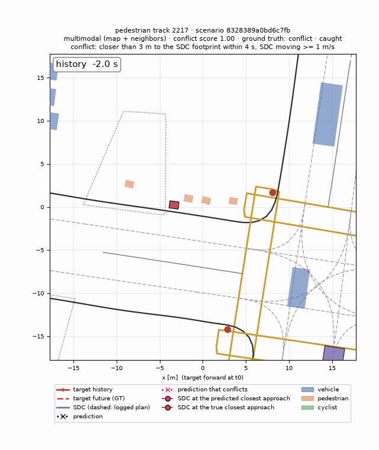
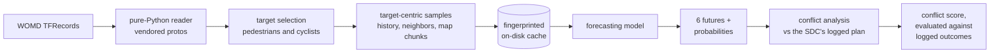
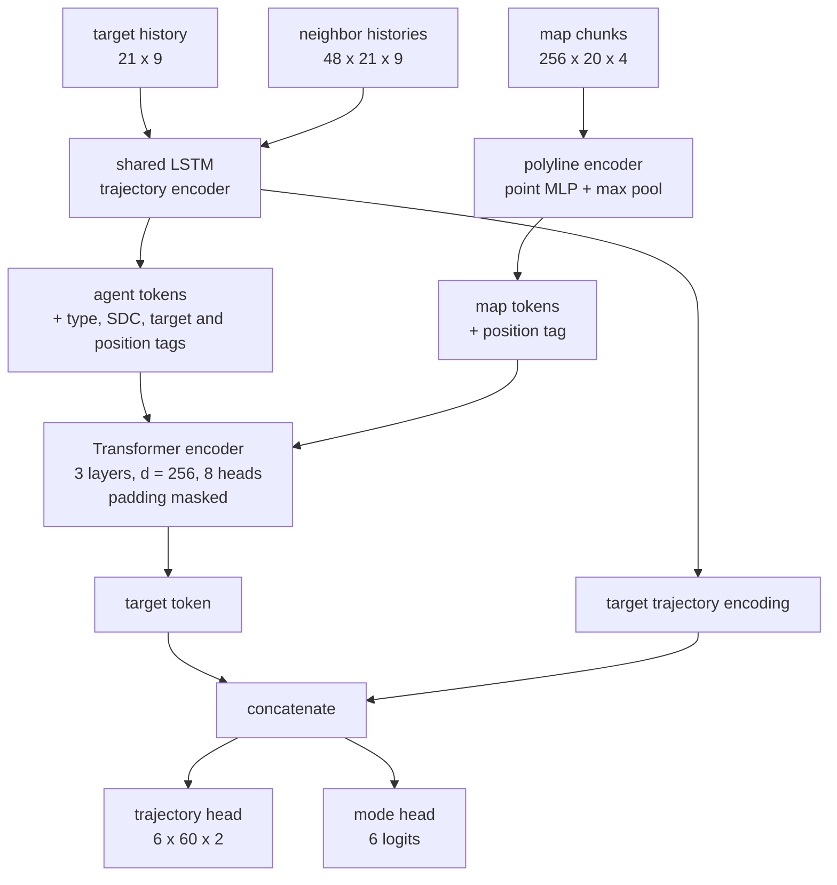
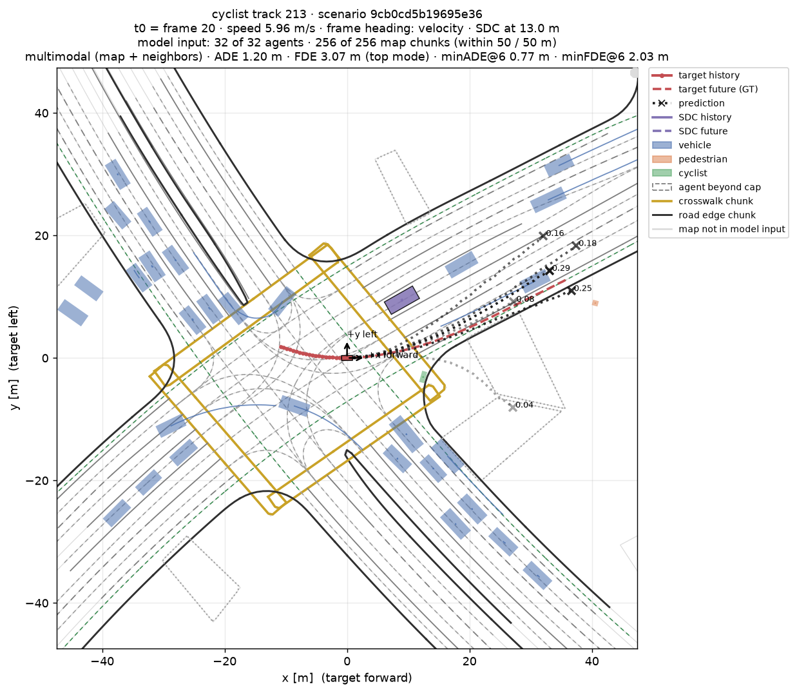
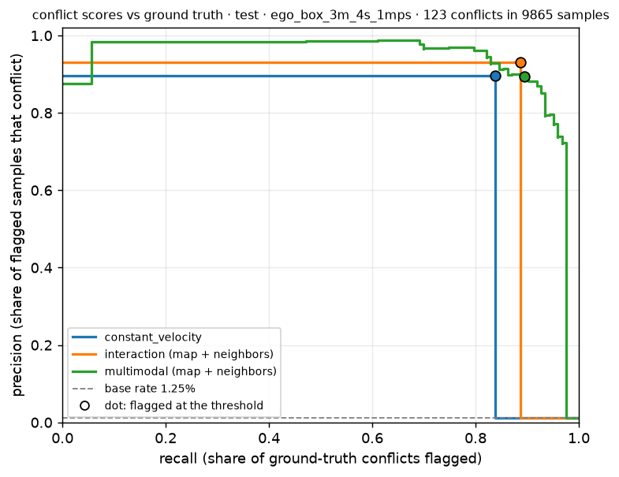
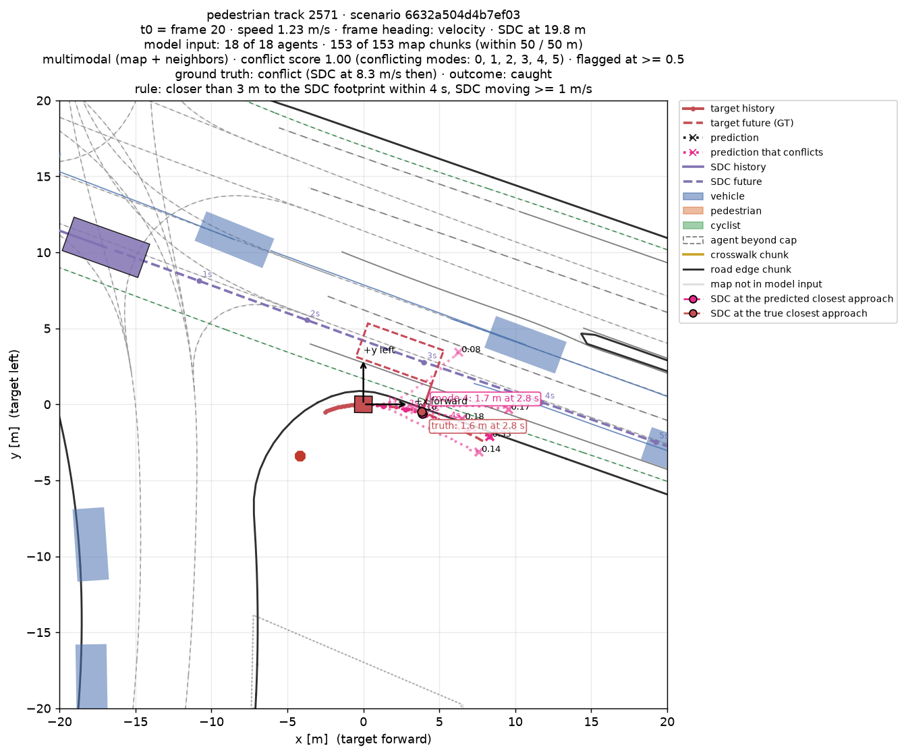
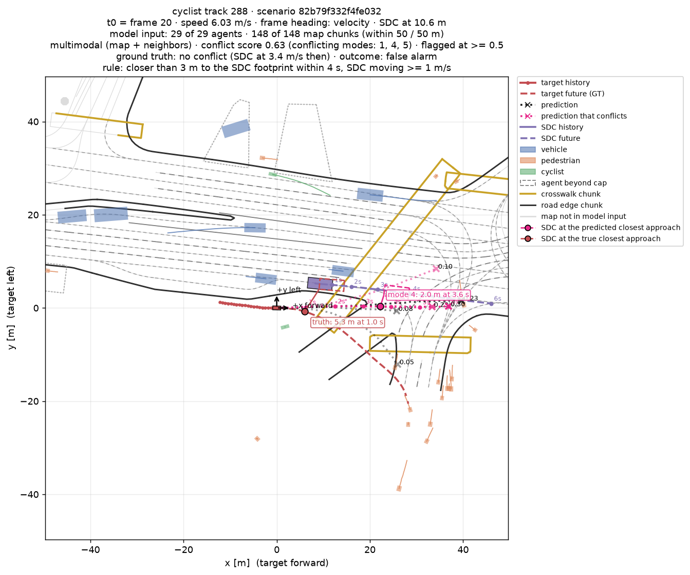

# Predictive Road Safety

Multimodal motion forecasting for pedestrians and cyclists on the
[Waymo Open Motion Dataset](https://waymo.com/open/) (WOMD v1.3.1), with an analysis of when a
forecast brings a person close to the self-driving car's planned path. Everything is built from
the raw TFRecords up, without TensorFlow, and every model is evaluated on one fixed sample set
with confidence intervals clustered by scene.



*A pedestrian walks toward a crosswalk while the self-driving car (purple) turns left across it.
The model's six futures appear at t0: more likely futures are more opaque, and magenta futures
come within 3 m of the car's footprint. Then the logged future plays out. The riskiest predicted
future and the real one both pass about 2.5 m from the car, 2.5 s ahead. Test split, scenario
`8328389a0bd6c7fb`.*

**Results on 11,159 test targets** (pedestrians and cyclists from 3,319 scenes):

- **Forecasting.**
  - The best single-future model cuts the average error of a constant-velocity forecast from
    0.95 m to 0.60 m over 6 s. Its miss rate (final error above 2 m) falls from 34.7% to 22.1%.
  - With six futures, the best of the six is off by 0.35 m on average, and only 7.2% of targets
    are missed by all six.
- **Conflicts.**
  - 123 of the 9,865 targets near the car truly come within 3 m of its footprint while it is
    moving.
  - Ranked by the multimodal conflict score, these cases reach an average precision of 0.93
    (95% interval 0.88–0.98). The scores of the single-future models reach 0.75 (constant
    velocity) and 0.83 (interaction model).

The project is a forecasting and evaluation study on logged data. It makes no claim about
real-world driving safety, and the conflict score is a ranking signal, not a probability.

## Contents

- [Motivation](#motivation)
- [Problem](#problem)
- [Architecture](#architecture)
- [Data](#data)
- [Setup](#setup)
- [Reproducing the results](#reproducing-the-results)
- [Evaluation](#evaluation)
- [Results](#results)
- [Speed](#speed)
- [Limitations](#limitations)
- [Future work](#future-work)
- [Training on a rented GPU](#training-on-a-rented-gpu)

## Motivation

Pedestrians and cyclists are the road users most exposed in a collision, and the hardest to
anticipate: they stop, turn, cut across and change their minds with little warning. A planner
needs more than one best guess of where a person will be. It needs a few plausible futures with
their likelihoods, and a way to ask which of them would bring the person close to the car.

This project builds that chain end to end on real driving logs, and measures every link:
- forecasts of each pedestrian and cyclist;
- a conflict check of each forecast against the car's plan;
- an evaluation of the conflict scores against what actually happened.

## Problem

**Forecasting.**
- **Input:** for each target pedestrian or cyclist at time t0:
  - the last 2 s of its motion (21 frames at 10 Hz);
  - up to 48 surrounding agents within 50 m, always including the self-driving car (SDC);
  - up to 256 map chunks within 50 m: lanes, road lines, road edges, crosswalks, speed bumps,
    driveways and stop signs, up to 20 points each at 1 m spacing.
- **Frame:** everything is expressed in a frame centered on the target at t0. Its +x axis points
  along the target's direction of travel when it moves at 0.5 m/s or more, otherwise along its
  heading.
- **Output:** K = 6 future paths over the next 6 s (60 frames), each with a probability.

**Conflict analysis** (geometric, not learned).
- **The ego plan:** the SDC's logged future is treated as its plan.
- **Separation:** for every predicted future of the person, the gap at each time step from the
  person to the car's footprint at that same moment, minus a 0.4 m body radius.
- **When a future conflicts:**
  - its closest approach is under 3 m;
  - it happens within 4 s;
  - the car is moving at 1 m/s or more at that moment.
- **Conflict score:** the summed probability of the conflicting futures.
- **Ground truth:** the same rule applied to the person's logged future.

## Architecture



The final model is a multi-agent Transformer:



**Design notes.**
- **Shared encoder:** neighbors share the target's LSTM encoder, so adding them changes the
  inputs, not the number of parameters.
- **Padding:** padded neighbor slots and map chunks are zeroed and excluded from attention. Tests
  confirm that extra padding and reordered slots leave the output unchanged.
- **Decoder input:** the decoder reads the raw trajectory encoding next to the Transformer
  output. Decoding the Transformer output alone underfit badly: validation ADE 0.76 m against
  0.65 m after 10 epochs.
- **Training:** the multimodal model is trained winner-takes-all.
  - **Trajectories:** only the future closest to the truth (lowest ADE) gets the smooth-L1
    trajectory loss.
  - **Mode head:** a cross-entropy loss teaches it to pick that future.
  - **Collapse:** each future's win rate is monitored for collapse; on test the rates are
    8–29%, so no future goes unused.

| Model | Inputs | Parameters |
|---|---|---:|
| Constant velocity | target history | 0 |
| LSTM | target history | 1,248,376 |
| LSTM + map | + map, through attention from the target to the map chunks | 1,688,760 |
| Interaction (history / neighbors) | Transformer over the target ± neighbors | 3,818,616 |
| Interaction (map / map + neighbors) | Transformer over the target, ± neighbors, map | 3,864,504 |
| Multimodal | interaction (map + neighbors), 6 futures + mode head | 4,305,174 |

## Data

**WOMD v1.3.1.**
- Registering for WOMD and accepting its license is required.
- Raw data lives under `data/` (git-ignored) and must not be redistributed.
- The figures in this README are renderings of WOMD scenes.

| Split | WOMD source | Targets | Use |
|---|---|---:|---|
| train | training shards 0–99 (of 1,000) | 64,633 | training |
| val | validation shards 0–14 | 5,738 | model selection, choosing the conflict threshold |
| test | validation shards 75–104 | 11,159 (3,319 scenes) | every reported number |

**Tiers.**
- **`exp`:** the tier in the table above, used for every reported number.
- **`dev`:** two training shards, one validation shard and one test shard. It only checks that the
  pipeline runs.
- **Shared samples:** both tiers have identical content settings, so they share one cache.
- **Labels:** WOMD's own test split hides the futures, so the test split here is drawn from WOMD
  validation shards that are never used for training or model selection.

**Targets.** Pedestrians and cyclists whose history and future are each at least 90% observed,
with an observed final frame. t0 is frame 20, so 2 s of history and 6 s of future fit in the
9.1 s scene.

## Setup

```bash
uv sync --all-extras    # Python >= 3.10; PyTorch with CUDA or Apple MPS
```

**No TensorFlow is needed.** WOMD records are parsed with vendored, trimmed protos
(`src/prs/data/raw/protos/`) and a pure-Python TFRecord reader.

**Getting the data:**
1. Register at https://waymo.com/open and accept the WOMD license.
2. Install the Google Cloud CLI and run `gcloud auth login` with the same account.
3. Download and MD5-verify the shards listed in a data config:

```bash
uv run python scripts/download_shards.py --config configs/data_exp.yaml
```

Run `uv run pytest -m "not slow"` for the fast checks. Plain `uv run pytest` adds slow overfit
checks, about 6 minutes in total.

## Reproducing the results

The training data is about 43 GB of raw shards and 10 GB of cache. Code comments cite sections of
a design document that is not part of this repository.

```bash
# 1. Data: download, inspect, build the processed-sample cache once
uv run python scripts/download_shards.py --config configs/data_exp.yaml
uv run python scripts/inspect_waymo.py --config configs/data_dev.yaml
uv run python scripts/visualize_sample.py --config configs/data_dev.yaml --examples 3
uv run python scripts/preprocess_waymo.py --config configs/data_exp.yaml

# 2. Train. The LSTMs fit on a laptop (resume with: train.py --resume outputs/runs/<name>);
#    the interaction ablation and the multimodal model need a GPU ("Training on a rented GPU")
uv run python scripts/train.py --config configs/lstm.yaml --data-config configs/data_exp.yaml \
    --name lstm_exp
uv run python scripts/train.py --config configs/lstm_map.yaml \
    --data-config configs/data_exp.yaml --name lstm_map_exp
bash scripts/train_all.sh configs/interaction_history.yaml configs/interaction_neighbors.yaml \
    configs/interaction_map.yaml configs/interaction.yaml configs/multimodal.yaml

# 3. Evaluate on the fixed test manifest (writes metrics, per-sample errors and predictions)
uv run python scripts/evaluate.py --config configs/baseline_cv.yaml \
    --data-config configs/data_exp.yaml --split test
uv run python scripts/evaluate.py --config configs/multimodal.yaml \
    --data-config configs/data_exp.yaml --checkpoint outputs/runs/multimodal_exp/best.pt --split test
uv run python scripts/evaluate.py --config configs/lstm_map.yaml \
    --data-config configs/data_exp.yaml --checkpoint outputs/runs/lstm_map_exp/best.pt \
    --split test --shuffle-map 0    # shuffled-map test: every sample gets another sample's map
uv run python scripts/make_results_table.py outputs/metrics/*/data_exp/test*.json \
    --out outputs/tables/exp_test.md
uv run python scripts/compare_models.py outputs/metrics/lstm/data_exp/test.json \
    outputs/metrics/lstm_map/data_exp/test.json    # paired, per-sample comparison

# 4. Conflict analysis: score saved predictions against ground-truth conflicts
uv run python scripts/evaluate_conflicts.py --config configs/multimodal.yaml \
    --data-config configs/data_exp.yaml outputs/metrics/baseline_cv/data_exp/test.json \
    outputs/metrics/interaction/data_exp/test.json outputs/metrics/multimodal/data_exp/test.json
uv run python scripts/evaluate_conflicts.py ... --conflict-distance-m 1.0    # sensitivity

# 5. Figures: forecasts, conflict examples (caught, false alarms, missed) and animations
uv run python scripts/visualize_prediction.py --config configs/multimodal.yaml \
    --checkpoint outputs/runs/multimodal_exp/best.pt --split test --examples 2 --animate
uv run python scripts/run_conflict_demo.py --config configs/multimodal.yaml \
    --checkpoint outputs/runs/multimodal_exp/best.pt --data-config configs/data_exp.yaml \
    --split test --num-samples 20 --only-conflicts --animate
uv run python scripts/run_conflict_demo.py ... --scenario-id <id> --target-track-id <id> --animate
uv run tensorboard --logdir outputs/runs
```

**Where outputs go:**

| Output | Path |
|---|---|
| Metrics | `outputs/metrics/<config>/<tier>/<split>.json`, with `.per_sample.npz` and `.predictions.npz` beside them |
| Sample manifests | `outputs/manifests/` |
| Training runs | `outputs/runs/` |
| Results tables | `outputs/tables/` |
| Conflict reports | `outputs/conflicts/` |
| Figures | `outputs/figures/` |

`notebooks/colab_train.ipynb` runs the same scripts on a Colab GPU.

## Evaluation

**Fair comparisons.**
- **Fixed sample set:** every model is scored on the same sample set, whose sorted keys are hashed
  into a manifest (`c18a803d7dc54af1` for `exp` test).
- **Refusing mismatches:** the table and comparison scripts refuse to combine results from
  different manifests.
- **Confidence intervals:** they are clustered by scene, because targets in one scene share
  place, moment and neighbors.
- **Paired comparisons:** two models are compared through per-sample differences, which are much
  sharper than two separate intervals. `*` marks a difference whose interval excludes zero.

**Metrics** (errors in metres over the 6 s horizon):
- **ADE / FDE:** average / final displacement error. For a multimodal model they are measured on
  its most likely future.
- **minADE@6 / minFDE@6:** the error of the best of the six futures.
- **Miss rate:** the share of targets whose best final error exceeds 2 m.
- **Conflict metrics:**
  - average precision (AP) of the conflict score against the ground-truth label;
  - precision and recall when flagging scores of 0.5 or more;
  - 95% intervals from 1,000 scene-level bootstrap resamples, paired between models.

**Not comparable with the WOMD leaderboard.** The official challenge differs in several ways:
- it predicts from frame 10, with 1.1 s of history, over 8 s;
- it scores selected tracks only;
- it uses speed-scaled miss thresholds at 3, 5 and 8 s, and mAP.

This project also trains on 10% of the training shards and filters targets (see
[Data](#data)).

## Results

### Forecasting

`exp` test split, 11,159 targets. Means ± 95% confidence intervals clustered by scene.

| Model | Map | Neighbors | Futures | ADE (m) | FDE (m) | minADE@6 (m) | minFDE@6 (m) | Miss rate |
|---|:-:|:-:|---:|---:|---:|---:|---:|---:|
| Constant velocity | | | 1 | 0.95 ± 0.03 | 2.22 ± 0.07 | | | 34.7% ± 1.0% |
| LSTM | | | 1 | 0.65 ± 0.02 | 1.65 ± 0.06 | | | 25.4% ± 1.0% |
| LSTM + map | ✓ | | 1 | 0.61 ± 0.02 | 1.51 ± 0.05 | | | 23.0% ± 1.0% |
| Interaction (history only) | | | 1 | 0.66 ± 0.02 | 1.66 ± 0.06 | | | 25.4% ± 1.0% |
| Interaction (map) | ✓ | | 1 | 0.61 ± 0.02 | 1.50 ± 0.05 | | | 22.8% ± 0.9% |
| Interaction (neighbors) | | ✓ | 1 | 0.62 ± 0.02 | 1.53 ± 0.05 | | | 23.1% ± 1.0% |
| Interaction (map + neighbors) | ✓ | ✓ | 1 | **0.60 ± 0.02** | **1.46 ± 0.05** | | | 22.1% ± 1.0% |
| Interaction (map + neighbors), 50 epochs | ✓ | ✓ | 1 | 0.59 ± 0.02 | 1.45 ± 0.05 | | | 21.8% ± 0.9% |
| **Multimodal** (map + neighbors) | ✓ | ✓ | 6 | 0.70 ± 0.02 | 1.70 ± 0.06 | **0.35 ± 0.01** | **0.77 ± 0.03** | **7.2% ± 0.6%** |

**Training budget.**
- Models train for 30 epochs, apart from the multimodal model and its 50-epoch interaction
  comparator, which train for 50.
- Both 50-epoch runs continue their 30-epoch run (`train.py --resume <run> --epochs 50`). The
  learning rate is constant, so this matches training for 50 epochs from the start.
- The epoch with the best validation ADE is kept (minADE@6 for the multimodal model).

**By class:**

| Model | Pedestrians (10,171): ADE | Miss rate | Cyclists (988): ADE | Miss rate |
|---|---:|---:|---:|---:|
| Constant velocity | 0.80 ± 0.02 | 30.4% | 2.54 ± 0.18 | 79.5% |
| LSTM | 0.53 ± 0.01 | 21.0% | 1.94 ± 0.15 | 70.7% |
| LSTM + map | 0.51 ± 0.01 | 19.4% | 1.67 ± 0.15 | 60.1% |
| Interaction (map + neighbors) | 0.48 ± 0.01 | 17.6% | 1.75 ± 0.14 | 69.0% |
| Interaction (map + neighbors), 50 epochs | 0.49 ± 0.01 | 18.0% | 1.63 ± 0.14 | 61.3% |
| Multimodal, minADE@6 | 0.29 ± 0.01 | 4.4% | 0.95 ± 0.11 | 36.3% |

Cyclists are 9% of the targets, but their errors are three to four times larger than
pedestrians'. They move faster, and their paths depend on lanes the model must infer.

### Ablations

Paired differences in ADE on the test split (negative = better), with scene-clustered 95%
intervals:

| Change | Overall | Pedestrians | Cyclists |
|---|---:|---:|---:|
| LSTM vs constant velocity | −0.30 ± 0.02* | | |
| + map (interaction, history only → map) | −0.057 ± 0.008* | −0.028 ± 0.005* | −0.353 ± 0.072* |
| + neighbors (history only → neighbors) | −0.047 ± 0.007* | −0.032 ± 0.004* | −0.202 ± 0.058* |
| + neighbors, given the map (map → map + neighbors) | −0.011 ± 0.007* | −0.022 ± 0.005* | +0.096 ± 0.057* |
| 30 → 50 epochs (map + neighbors) | −0.007 ± 0.005* | +0.005 ± 0.003* | −0.123 ± 0.053* |

**What the ablations show.**
- **Map and neighbors:** each helps on its own, and moving targets gain the most.
- **Cyclists:** with both inputs at 30 epochs, the model was worse on cyclists than the map-only
  model. Training it for 50 epochs closed that gap (cyclist ADE 1.75 → 1.63 m).
- **Does the model use the map?** Giving every sample another sample's map makes the map models
  clearly worse than the models without a map (ADE 0.74–0.78 m). So they really use the road
  geometry.

| Map model | ADE with its own map | ADE with a shuffled map |
|---|---:|---:|
| LSTM + map | 0.61 | 0.76 |
| Interaction (map) | 0.61 | 0.78 |
| Interaction (map + neighbors) | 0.60 | 0.74 |

### Multimodal forecasts



*A cyclist at 6 m/s crossing a large intersection. The six futures fan out across the lanes, and
one turns right. The logged path (red, dashed) runs between the two most likely futures. Test
split.*

**Six futures against one.** Compared with the same architecture predicting one future for the
same 50 epochs:
- **Miss rate:** it falls from 21.8% to 7.2% (−14.6 ± 0.8 points; cyclists −25.0 ± 3.3).
- **Most likely future:** on its own it is less accurate (ADE +0.11 ± 0.01 m). That is the
  expected cost of winner-takes-all training. Each future specializes in a subset of behaviors
  rather than in the average, and the average is what minimizes ADE.

**Mode probabilities.**
- The most likely future is also the best one for 43% of targets. Picking one of the six at
  random would be right 17% of the time.
- Its probability is close to calibrated: expected calibration error 0.023.

### Conflict analysis

**The conflict threshold.**
- **The original 1 m rule:** it left only 7 conflicts among the 9,865 test targets near the car.
  Most close passes happen while the car is stopped or yielding.
- **Choosing 3 m:** the 3 m threshold was chosen from validation counts (43 conflicts) before any
  test scores were looked at.
- **Analyzed targets:** those within 50 m of the SDC at t0.
- **Reference rows:**
  - "Interaction" is the 50-epoch single-future model;
  - single-future models have a score of 0 or 1.

| Model | AP (95% interval) | AP − constant velocity | Precision at 0.5 | Recall at 0.5 |
|---|---:|---:|---:|---:|
| Constant velocity | 0.752 (0.666–0.829) | | 0.90 | 0.84 |
| Interaction (map + neighbors) | 0.827 (0.752–0.892) | +0.075 (−0.003 to 0.159) | 0.93 | 0.89 |
| **Multimodal** | **0.934 (0.880–0.977)** | **+0.182 (0.104 to 0.262)*** | 0.89 | 0.89 |

123 ground-truth conflicts (1.25% base rate); pedestrians 84, cyclists 39.

**Multimodal against the interaction model.**
- **Overall:** its AP is +0.107 higher (0.045 to 0.175)*.
- **Cyclists:** the AP is 0.950 against 0.758.

**Reading these numbers.**
- **AP rewards a graded score.** A single-future model can only answer yes or no, so its AP is
  that of a single operating point.
- **At a fixed threshold the models are close.** When flagging scores of 0.5 or more, the three
  models' precision and recall are similar. The multimodal score's advantage is that it can be
  thresholded for higher recall. See the precision-recall curves below.
- **Many conflicts are easy.** 37% of the conflicts are already within 3 m at +0.1 s, so even a
  forecast that stands still reaches AP 0.42.
- **Open loop.** The logged car already reacted to the person, so these are near-misses, not
  collisions. A different plan would have produced a different future.
- **Hard thresholds create knife-edge cases.** Some misses are centimetres from 3 m, in the
  truth or in the forecast.
- **The 1 m rule is too sparse to rank models.** With only 7 conflicts its intervals are very
  wide (AP: constant velocity 0.43, interaction 0.47, multimodal 0.81).



**Examples.** On the test split at the 0.5 threshold, the multimodal model catches 110 of the
123 conflicts, misses 13, and raises 13 false alarms. Run `scripts/run_conflict_demo.py
--only-conflicts` to draw a mix of all three.



*Caught: a pedestrian at a street corner walks along the edge of the road as the car passes at
8.3 m/s. The riskiest forecast and the truth both come within about 1.6 m of the car at 2.8 s.*
- **Car's footprint:** the dashed boxes show where it is at the predicted closest approach
  (magenta) and at the true one (red).
- **Time:** the dots along the car's path and the riskiest future mark each second.



*False alarm (score 0.63): a cyclist riding at 6 m/s behind a slower car. The conflicting
futures keep the cyclist going straight, closing in on the car; the cyclist turned right
instead.*

## Speed

Throughput from the training logs (batch 64, training samples per second):

| Model | Hardware | Samples/s | Epoch | Full run |
|---|---|---:|---:|---:|
| LSTM | Apple M3 (MPS) | ≈ 2,300 | 28 s | 30 epochs, ≈ 15 min |
| LSTM + map | Apple M3 (MPS) | ≈ 360 | ≈ 180 s | 30 epochs, ≈ 1.6 h |
| Interaction (map + neighbors) | Apple M3 (MPS) | ≈ 78 | | ≈ 7 h estimated for 30 epochs |
| Interaction (history only) | RTX 4090 | ≈ 9,800 | 7 s | |
| Interaction (map + neighbors) | RTX 4090 | ≈ 1,380 | 47 s | 30 epochs, ≈ 25 min |
| Multimodal | RTX 4090 | ≈ 1,370 | 47 s | 50 epochs, ≈ 40 min |

**Other timings.**
- **Model costs:** the full model's cost splits between three parts:
  - the per-agent LSTM, with about 33 real neighbors per sample;
  - the map encoder;
  - the Transformer, over up to 306 tokens.
- **Caching:** building the `exp` training cache takes about 4 minutes with 4 workers.
- **Inference:** running the multimodal model over the 11,159 test targets takes about 50 s on
  the M3.

## Limitations

- **Open-loop conflict analysis.**
  - The car's plan is its logged future, which already reacted to the people around it.
  - The conflict labels describe near-misses in human-supervised driving, not what would happen
    under a different plan.
- **Uncalibrated, heuristic conflict scores.**
  - The score is a sum of mode probabilities, not a calibrated probability of conflict.
  - The rule's thresholds are project heuristics, not safety standards:
    - 3 m, chosen on the validation split;
    - 4 s;
    - 1 m/s;
    - a 0.4 m body radius.
- **Subset training.** The models are trained on 100 of WOMD's 1,000 training shards. Cyclist
  results rest on 988 test targets and 39 conflicts.
- **No pedestrian signals.** Traffic-light and walk-signal states are not inputs, and neither is
  any perception data beyond tracked boxes.
- **Future-validity filter.**
  - Targets must be observed for at least 90% of their future and at its last frame.
  - This drops people who become occluded or leave the scene, and probably favors easier cases.
- **Single-future accuracy.** The multimodal model's most likely future is less accurate than the
  single-future model's forecast. A downstream user should consume all six futures, not only the
  top one.

## Future work

- **Better multimodal heads:** endpoint anchors, Gaussian mixtures, or query-based decoders in the
  style of MTR.
- **Inputs:** traffic-light states and richer lane topology.
- **Calibrated risk:** a learned or conformal conflict probability, and a soft risk score instead
  of a hard 3 m cut.
- **Counterfactual ego plans** (WOMD's `sdc_paths`): score several candidate plans and pick the
  lowest-risk feasible one.
- **Scale:** the full training set and the official WOMD metrics, for leaderboard-comparable
  numbers.
- **Deployment:** export to ONNX / TensorRT and profile on embedded hardware.

## Training on a rented GPU

**The machine.**
- **Pod:** the interaction models train on a rented NVIDIA GPU, a RunPod RTX 4090 (Secure Cloud,
  EU-RO-1) with a 50 GB network volume mounted at `/workspace`.
- **CUDA:** the locked PyTorch build needs a driver that supports CUDA 13, so set the pod's
  minimum CUDA version to 13.0.

**Keeping credentials off the pod.**
- Neither a GitHub token nor a Google sign-in goes to the pod.
- The code arrives as a git bundle, and the processed cache is uploaded from the Mac.
- `<pod-ip>` and `<port>` come from the pod's "SSH over exposed TCP" address.

```bash
# On the Mac: send the code as a git bundle, then the train and val cache shards (≈ 8.6 GB;
# the test shards stay on the Mac, which evaluates)
git bundle create /tmp/road-predict.bundle main
scp -P <port> /tmp/road-predict.bundle root@<pod-ip>:/workspace/
ssh -p <port> root@<pod-ip> 'cd /workspace && git clone -b main road-predict.bundle road-predict'
cd data/cache/cbf01840f6c1aaea
rsync -r -t -e "ssh -p <port>" training.tfrecord-* validation.tfrecord-0000[0-9]-* \
    validation.tfrecord-0001[0-4]-* root@<pod-ip>:/workspace/road-predict/data/cache/cbf01840f6c1aaea/

# On the pod, on every new pod (and in every new shell: source scripts/remote_env.sh)
cd /workspace/road-predict && source scripts/remote_env.sh
bash scripts/remote_setup.sh              # uv, the virtualenv on the volume, a CUDA check

# Train inside tmux, so closing the laptop does not stop it; rerun the same line to resume
tmux new -s train
bash scripts/train_all.sh configs/interaction_history.yaml configs/interaction_neighbors.yaml \
    configs/interaction_map.yaml configs/interaction.yaml configs/multimodal.yaml
```

**Updating the code later:** create a new bundle, copy it over, then run
`git pull road-predict.bundle main` in `/workspace/road-predict`.

**Downloading WOMD on the pod instead.** This is faster than a slow home upload, but it puts a
Google Cloud credential on the pod. Revoke it with `gcloud auth revoke` afterwards.
1. Run `bash scripts/remote_setup.sh --with-gcloud`.
2. Run `gcloud auth login --no-launch-browser` with the WOMD-registered account.
3. Run `download_shards.py --config configs/data_exp.yaml --splits train val`.
4. Run `preprocess_waymo.py ... --splits train val --workers 8 --delete-raw-after`.

The raw shards (≈ 47 GB) do not fit beside the rest on a 50 GB volume, so link `data/raw` to the
container disk first.

**Evaluating.** Copy the finished runs back and evaluate them on the Mac, which holds the `exp`
test split:

```bash
rsync -r -t -e "ssh -p <port>" root@<pod-ip>:/workspace/road-predict/outputs/runs/ outputs/runs/
```

**When training ends:**
- **Stop the pod.** A stopped pod costs nothing for its GPU, and the volume keeps the code, the
  virtualenv, the cache and the runs.
- **Delete the volume when the project is done.** It is billed while it exists.
- **Keep the volume private.** It holds WOMD data.
