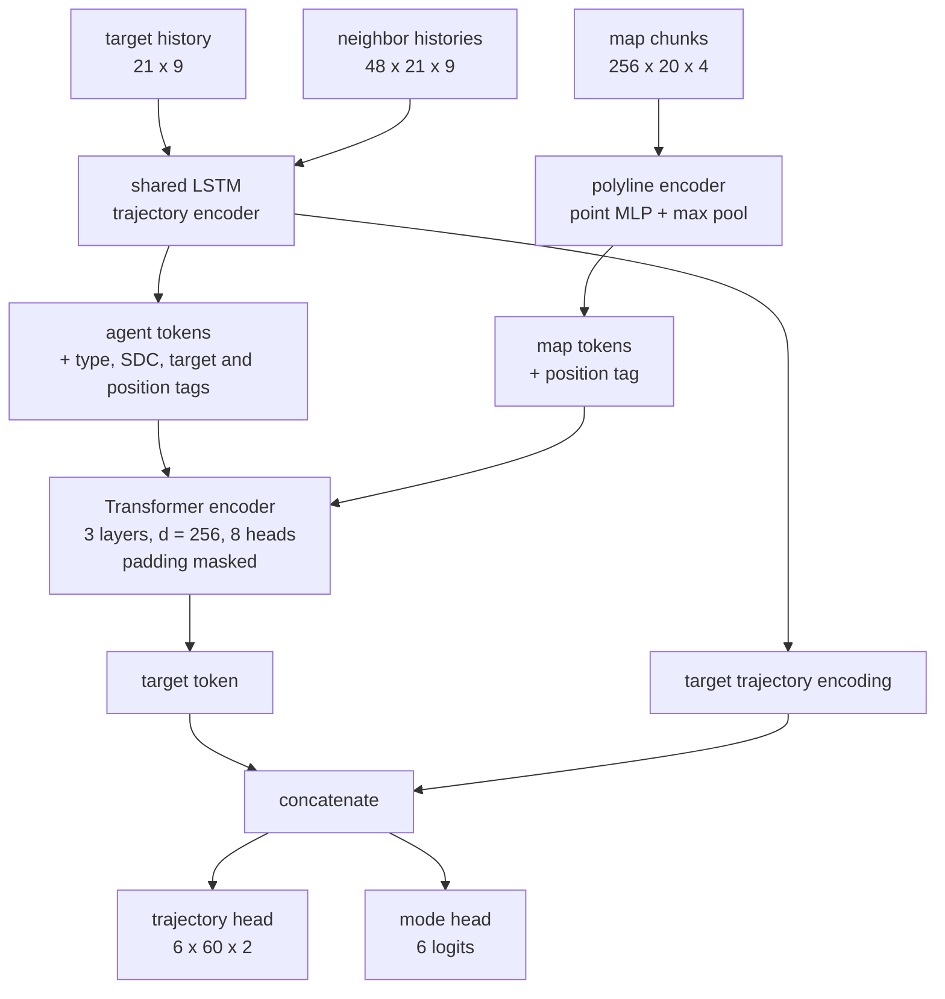
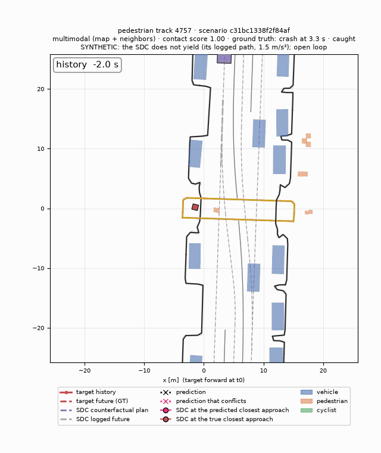

# Predictive Road Safety

Pedestrians and cyclists are the hardest road users to anticipate: they stop, turn and cross
with little warning. This project forecasts where they will go over the next 6 seconds, with
several possible futures and a probability for each, and checks which futures bring them close
to a self-driving car. It is built on the [Waymo Open Motion Dataset](https://waymo.com/open/)
(WOMD v1.3.1), from the raw records up and without TensorFlow. Every model is evaluated on one
fixed test set, with confidence intervals clustered by scene.


*The self-driving car (purple) turns left across a crosswalk as a pedestrian approaches. The
model's six futures appear at t0, with more likely ones more opaque and those that come within
3 m of the car in magenta. Then the real future plays out. Both the riskiest prediction and the
truth pass about 2.5 m from the car, 2.5 s ahead.*

**Results on 11,159 test pedestrians and cyclists:**
- **Forecasting.**
  - Average error over 6 s drops from 0.95 m (constant velocity) to 0.60 m.
  - With six futures, the best one is off by 0.35 m, and only 7.2% of targets are missed by
    all six.
- **Near-misses.** The multimodal conflict score finds the 123 real close calls with the car
  at an average precision of **0.93**, against 0.75 for constant velocity.
- **Synthetic crashes.** WOMD has no collisions, so the car is replayed along its own path
  without yielding.
  - The forecasts flag the resulting 40 crashes at AP **0.71**, against 0.23 for constant
    velocity.
  - For 92% of them, the forecast rates the crashing plan riskier than the one the car really
    drove.

This is a forecasting and evaluation study on logged data. It makes no claim about real-world
safety, and its scores are rankings, not calibrated probabilities.

## How it works

**Forecasting.**
- **Input:** for each pedestrian or cyclist at time t0:
  - its last 2 s of motion;
  - up to 48 nearby agents, including the self-driving car (SDC);
  - up to 256 map pieces within 50 m: lanes, road edges, crosswalks and stop signs.
- **Frame:** everything is centered on the target.
- **Output:** six future paths over 6 s, each with a probability.

**Conflict check** (geometry, not learned).
- **The car's plan:** its logged future.
- **When a predicted future conflicts:**
  - it comes within 3 m of the car's footprint, less a 0.4 m body radius;
  - this happens within 4 s;
  - the car is moving at that moment.
- **Conflict score:** the summed probability of the conflicting futures.
- **Ground truth:** the same rule applied to the person's real future.

**Model.** The final model is a Transformer over the target, its neighbors and the map:



**Design notes.**
- **Decoder input:** the decoder reads the target's own trajectory encoding next to the
  Transformer output. Decoding the Transformer output alone underfit badly.
- **Multimodal training:** winner-takes-all. Only the future closest to the truth is trained
  on the path, and the mode head learns to pick it. Each of the six futures wins 8–29% of the
  time, so none goes unused.

| Model | Inputs | Parameters |
|---|---|---:|
| Constant velocity | target history | 0 |
| LSTM | target history | 1.25 M |
| LSTM + map | + map | 1.69 M |
| Interaction | Transformer over the target, ± neighbors, ± map | 3.82–3.86 M |
| Multimodal | interaction (map + neighbors), 6 futures + probabilities | 4.31 M |

## Results

All numbers are on the test split: 11,159 targets from 3,319 scenes. ± is a 95% confidence
interval clustered by scene.

### Forecasting

| Model | Map | Neighbors | Futures | ADE (m) | FDE (m) | minADE@6 (m) | minFDE@6 (m) | Miss rate |
|---|:-:|:-:|---:|---:|---:|---:|---:|---:|
| Constant velocity | | | 1 | 0.95 ± 0.03 | 2.22 ± 0.07 | | | 34.7% ± 1.0% |
| LSTM | | | 1 | 0.65 ± 0.02 | 1.65 ± 0.06 | | | 25.4% ± 1.0% |
| LSTM + map | ✓ | | 1 | 0.61 ± 0.02 | 1.51 ± 0.05 | | | 23.0% ± 1.0% |
| Interaction (history only) | | | 1 | 0.66 ± 0.02 | 1.66 ± 0.06 | | | 25.4% ± 1.0% |
| Interaction (map) | ✓ | | 1 | 0.61 ± 0.02 | 1.50 ± 0.05 | | | 22.8% ± 0.9% |
| Interaction (neighbors) | | ✓ | 1 | 0.62 ± 0.02 | 1.53 ± 0.05 | | | 23.1% ± 1.0% |
| Interaction (map + neighbors) | ✓ | ✓ | 1 | **0.60 ± 0.02** | **1.46 ± 0.05** | | | 22.1% ± 1.0% |
| **Multimodal** | ✓ | ✓ | 6 | 0.70 ± 0.02 | 1.70 ± 0.06 | **0.35 ± 0.01** | **0.77 ± 0.03** | **7.2% ± 0.6%** |

**Metrics.**
- **ADE / FDE:** average and final error. For the multimodal model they are measured on its
  most likely future.
- **Miss rate:** the share of targets whose best final error exceeds 2 m.

**Cyclists.** They are 9% of the targets, but their errors are three to four times larger than
pedestrians' (constant velocity: 2.54 m against 0.80 m ADE).

**What helps.** These are paired, per-sample ADE differences.
- **Map:** −0.057 ± 0.008 m.
- **Neighbors:** −0.047 ± 0.007 m.
- **Both inputs:** each helps, and moving targets gain the most.
- **The model reads the road:** giving every sample another sample's map makes the map models
  worse than the models without one (0.74–0.78 m).
- **Cyclists:** with both inputs at 30 epochs, cyclist error got worse than with the map
  alone. Training to 50 epochs fixed that (1.75 → 1.63 m).

### Six futures instead of one


*A cyclist at 6 m/s crossing a large intersection. The six futures fan out across the lanes, and
one turns right. The real path (red, dashed) runs between the two most likely futures.*

Compared with the same model predicting one future (both trained for 50 epochs):
- **Misses:** the miss rate falls from 21.8% to 7.2%, and for cyclists from 61% to 36%.
- **The single most likely future** is less accurate: ADE 0.70 against 0.59 m. That is the
  expected cost of winner-takes-all training. Each future specializes in one kind of behavior
  instead of averaging them.
- **Probabilities:** the most likely future is the best one 43% of the time (a random pick:
  17%), and its probability is well calibrated (calibration error 0.023).

### Near-misses with the car

Of the 9,865 targets within 50 m of the car, 123 truly come within 3 m of it while it moves
(1.25%).

| Model | AP (95% interval) | AP − constant velocity | Precision at 0.5 | Recall at 0.5 |
|---|---:|---:|---:|---:|
| Constant velocity | 0.752 (0.666–0.829) | | 0.90 | 0.84 |
| Interaction (map + neighbors, 50 epochs) | 0.827 (0.752–0.892) | +0.075 (−0.003 to 0.159) | 0.93 | 0.89 |
| **Multimodal** | **0.934 (0.880–0.977)** | **+0.182 (0.104 to 0.262)** | 0.89 | 0.89 |

**Reading this table.**
- **AP rewards a graded score.** A single-future model can only say yes or no. At the fixed 0.5
  threshold the three models are close. The multimodal score's advantage is that it can trade
  precision for recall.
- **Many near-misses are easy.** 37% are already within 3 m at the first predicted step, so even
  a forecast that stands still reaches AP 0.42.
- **The threshold was moved from 1 m to 3 m.** A 1 m rule left only 7 test cases, too few to
  compare models. The 3 m rule was chosen on validation counts before any test scores were
  seen.


*A false alarm (score 0.63). A cyclist at 6 m/s closes in on a slower car, and most of the
forecast has them riding straight on toward it. The cyclist turned right instead. At 0.5, the
multimodal model catches 110 of the 123 near-misses, misses 13, and raises 13 false alarms.*

### Synthetic crashes

WOMD contains no collisions: the logged car slowed or stopped for every person it met. To test
the forecasts against actual crashes, the car is replayed with a plan that does not yield
(`prs.risk.counterfactual`).

**The plan.**
- **Path:** the car's own route, extended past its end along its last curve.
- **Speed:** never slower than it really drove. From its real speed it accelerates at 1.5 m/s²
  up to the fastest it drove in the scene.
- **Other vehicles:** it still stops for cars. It ignores only people.

**Labels.**
- **Crash:** the person's real path touches the car's footprint while the car is moving.
- **Forecasts:** they only see the 2 s before t0, so the saved predictions apply unchanged. No
  retraining or re-inference is needed.
- **Contact score:** the probability of the predicted futures that touch the plan.



*A pedestrian starts across a mid-block crosswalk. The real car slowed to a crawl about 3 m
short of it; the counterfactual car keeps going. All six predicted futures touch its path, and
contact comes 3.3 s after the forecast.*

The no-yield plans produce 40 crashes among the 9,865 targets near the car (33 pedestrians,
7 cyclists). The logged plans produce none.

| Model (contact score) | AP (95% interval) | Precision at 0.5 | Recall at 0.5 | Rates the crashing plan riskier than the real one |
|---|---:|---:|---:|---:|
| Constant velocity | 0.230 (0.114–0.367) | 0.42 | 0.55 | 52% |
| Interaction (map + neighbors) | 0.406 (0.244–0.576) | 0.60 | 0.68 | 68% |
| **Multimodal** | **0.705 (0.544–0.834)** | 0.67 | 0.70 | **92%** |

**What this shows.**
- **Model differences:** the multimodal model beats both others, on paired bootstrap
  differences: +0.475 AP over constant velocity and +0.299 over the interaction model.
- **Never the wrong way:** no model ever rates the crashing plan as the safer one.
- **Early warning:** more than half the crashes come over 4 s after the forecast. The
  multimodal model flags 57% of those, against 33% for constant velocity.
- **The near-miss score is not a crash detector:** the 3 m score reaches only about 0.05 AP
  here.
- **Stable to the plan:** with an acceleration of 1 or 3 m/s² the results hold (multimodal AP
  0.70 or 0.74).

**Caveats.**
- **Synthetic and open loop.** People reacted to the real car, not to this one, so a "crash"
  means a real path meets a hypothetical plan.
- **Extended paths:** 37 of the 40 contacts happen past the end of the car's logged path. Every
  crash figure was checked by eye, and the extended paths stay on the road.
- **Small sample:** 40 events give wide intervals.

## Evaluation notes

- **Same samples for every model:** a hashed manifest guarantees it, and the scripts refuse to
  compare results from different sample sets.
- **Confidence intervals:** they are clustered by scene, because targets in one scene are not
  independent.
- **Model comparisons:** they use paired, per-sample differences or paired bootstrap draws.
- **Not comparable with the WOMD leaderboard.** The official challenge:
  - predicts from frame 10, over 8 s;
  - scores selected tracks with speed-scaled thresholds and mAP.

  This project trains on 10% of the training data.

## Limitations

- **Open loop:** the car's plan is its logged future, which already reacted to the people
  around it.
- **Heuristic thresholds:** 3 m, 4 s, 1 m/s and a 0.4 m radius are project heuristics, not
  safety standards. The scores are not calibrated probabilities.
- **Subset of the data:**
  - the models train on 100 of WOMD's 1,000 training shards;
  - cyclist results rest on small counts (988 targets, 39 near-misses, 7 crashes).
- **No signals:** traffic-light and walk-signal states are not inputs.
- **Easier targets:** people must be observed for at least 90% of their future, which drops
  those who become occluded.
- **Simple counterfactual plans:**
  - one family of plans;
  - paths extended by curvature, not along the lane graph;
  - the car stops for good for another vehicle rather than following it.

## Future work

- **Multimodal output:** endpoint anchors, Gaussian mixtures or query-based decoders (MTR).
- **Inputs:** traffic-light states and richer lane topology.
- **Risk:** calibrated or conformal conflict probabilities instead of a hard 3 m cut.
- **Planning:** richer counterfactual plans (WOMD's `sdc_paths`, car-following), ranked to pick
  the lowest-risk feasible one.
- **Scale and deployment:** the full training set, the official WOMD metrics, and export to ONNX
  / TensorRT.

## Setup

```bash
uv sync --all-extras    # Python >= 3.10; PyTorch with CUDA or Apple MPS
uv run pytest -m "not slow"
```

**Getting the data.** WOMD requires registering at https://waymo.com/open and accepting its
license.
1. Run `gcloud auth login` with that account.
2. Run `uv run python scripts/download_shards.py --config configs/data_exp.yaml`.

Raw data lives under `data/` (git-ignored) and must not be redistributed. The figures here are
renderings of WOMD scenes.

**Splits.**

| Split | Source | Size |
|---|---|---|
| train | WOMD training shards 0–99 | 64,633 targets |
| val | validation shards 0–14 | 5,738 targets; model selection and the 3 m threshold |
| test | validation shards 75–104 | 11,159 targets |

**Targets.** Pedestrians and cyclists with at least 90% of their history and future observed.
Predictions start at frame 20, after 2 s of history.

**Speed.**
- **On an Apple M3:** the LSTM trains in about 15 minutes. The full interaction model would take
  about 7 hours.
- **On an RTX 4090:** the full model takes about 25 minutes for 30 epochs, and the multimodal
  model about 40 minutes for 50.
- **Test-set inference** for the multimodal model takes about 50 s on the M3.

<details>
<summary><b>Reproducing the results</b></summary>

The training data is about 43 GB of raw shards and 10 GB of cache. Code comments cite sections of
a design document that is not part of this repository.

```bash
# 1. Build the processed-sample cache once
uv run python scripts/preprocess_waymo.py --config configs/data_exp.yaml

# 2. Train (resume with: train.py --resume outputs/runs/<name>). The LSTMs fit on a laptop;
#    the interaction and multimodal models need a CUDA GPU
uv run python scripts/train.py --config configs/lstm.yaml --data-config configs/data_exp.yaml \
    --name lstm_exp
uv run python scripts/train.py --config configs/lstm_map.yaml \
    --data-config configs/data_exp.yaml --name lstm_map_exp
bash scripts/train_all.sh configs/interaction_history.yaml configs/interaction_neighbors.yaml \
    configs/interaction_map.yaml configs/interaction.yaml configs/multimodal.yaml

# 3. Evaluate on the fixed test manifest (metrics, per-sample errors and saved predictions)
uv run python scripts/evaluate.py --config configs/baseline_cv.yaml \
    --data-config configs/data_exp.yaml --split test
uv run python scripts/evaluate.py --config configs/multimodal.yaml \
    --data-config configs/data_exp.yaml --checkpoint outputs/runs/multimodal_exp/best.pt --split test
uv run python scripts/evaluate.py --config configs/lstm_map.yaml \
    --data-config configs/data_exp.yaml --checkpoint outputs/runs/lstm_map_exp/best.pt \
    --split test --shuffle-map 0    # shuffled-map test
uv run python scripts/make_results_table.py outputs/metrics/*/data_exp/test*.json \
    --out outputs/tables/exp_test.md
uv run python scripts/compare_models.py outputs/metrics/lstm/data_exp/test.json \
    outputs/metrics/lstm_map/data_exp/test.json    # paired comparison

# 4. Near-misses and synthetic crashes, from the saved predictions
uv run python scripts/evaluate_conflicts.py --config configs/multimodal.yaml \
    --data-config configs/data_exp.yaml outputs/metrics/baseline_cv/data_exp/test.json \
    outputs/metrics/interaction/data_exp/test.json outputs/metrics/multimodal/data_exp/test.json
uv run python scripts/evaluate_counterfactuals.py --config configs/multimodal.yaml \
    --data-config configs/data_exp.yaml outputs/metrics/baseline_cv/data_exp/test.json \
    outputs/metrics/interaction/data_exp/test.json outputs/metrics/multimodal/data_exp/test.json

# 5. Figures and animations
uv run python scripts/visualize_prediction.py --config configs/multimodal.yaml \
    --checkpoint outputs/runs/multimodal_exp/best.pt --split test --examples 2 --animate
uv run python scripts/run_conflict_demo.py --config configs/multimodal.yaml \
    --checkpoint outputs/runs/multimodal_exp/best.pt --data-config configs/data_exp.yaml \
    --split test --num-samples 20 --only-conflicts --animate    # add --plan no_yield for crashes
```

Outputs go to `outputs/`, which is git-ignored:

| Output | Path |
|---|---|
| Metrics | `outputs/metrics/` |
| Training runs | `outputs/runs/` |
| Results tables | `outputs/tables/` |
| Near-miss reports | `outputs/conflicts/` |
| Synthetic-crash reports | `outputs/counterfactuals/` |
| Figures | `outputs/figures/` |

</details>
